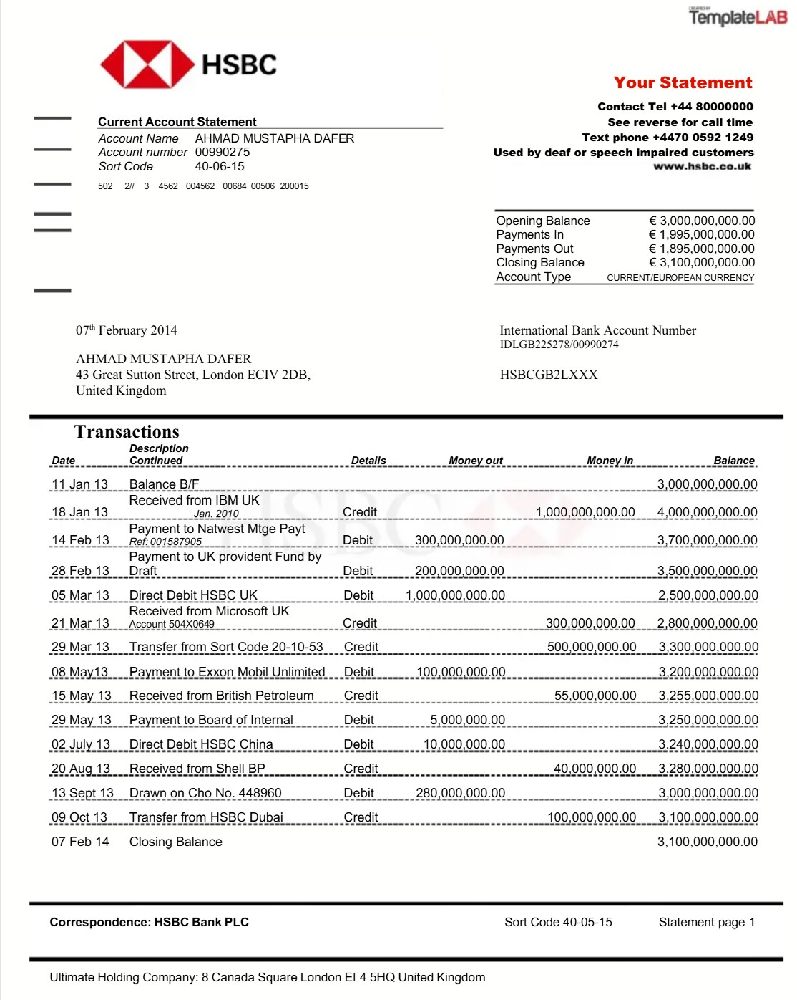

# HSBC PDF Statement Converter & Multi-account Ledger Dashboard

Local personal finance pipeline: extract transactions from HSBC text-based statement PDFs, categorise them, store them in SQLite, and explore them through a dashboard with classic reports. The multi-account workflow supports separately configured HSBC UK and HSBC Isle of Man GBP accounts, saved statement folders, and explicitly confirmed internal transfers. Account ownership, currency and parser eligibility require reviewed setup; a fresh checkout does not create or enable those accounts.

See [Multi-account setup and transfers](docs/multi-account-transfers.md) for prerequisites, import review and report semantics. Account workflow support is not blanket verification of every statement layout.

## Security

- Loopback-only local dashboard; no remote authentication support. Never expose it through a network bind or proxy.
- Processing is entirely local — no external API calls.
- The extractor ignores statement header data (name/address/account details) and only emits transaction rows.
- The whole `StatementsPDF/` tree (including nested account folders), downloaded CSVs, ledger, exports, reports and local backups are gitignored. Ignoring files is not encryption and does not remove anything already tracked by Git.

## Local safety helpers (M0)

`get_settings(root=None)` in `scripts/settings.py` centralises paths for the dashboard,
ingestion, imports, report generators, safety helpers and database initialisation. The default is this repository root, independent
of the current working directory. `BANKSTATEMENT_PROJECT_ROOT` overrides that root;
an explicit API/CLI root takes precedence. It includes StatementsPDF, TransactionsCSV,
config, database, exports, reports, templates and static asset paths. Path discovery
does not create directories or open the ledger.

### Production local dashboard and Safety page

Use `start_dashboard.bat`, which changes to its own project directory and uses
`.venv/Scripts/python.exe`, or run:

```bash
uv pip install --python .venv/Scripts/python.exe -r requirements.txt
.venv/Scripts/python.exe -m scripts.serve_dashboard --open-browser
```

Waitress 3.0.2 serves only `127.0.0.1` (default port 5000, `--port` changes it),
without Flask debug/reloader. The launcher checks `/health` for this app and project
identity before opening the browser; an existing matching instance is reused and an
unrelated occupied port is refused. No hardcoded credentials are installed.

All requests validate the local Host; cross-origin/cross-site requests are refused.
Forms and JSON mutations require an unpredictable session-bound CSRF token. Report
editing obtains it through same-origin `/api/csrf-token`; no wildcard CORS is enabled.
The signing secret is random per process unless `BANKSTATEMENT_SESSION_SECRET` is set
privately in the server environment; a restart may require reloading open pages.
This is not authentication or a sandbox against malicious software on this computer.

Chart.js 4.4.8 and its MIT license are in `static/vendor/`, with source/hash attribution.
Reports load browser assets locally. Existing generated report bytes are not rewritten:
approved legacy Chart.js references and API calls are adapted only in served responses.
Standalone `file:` HTML editing is unsupported; open reports through `/report`.

`/safety` is read-only on GET and shows snapshot verification/record counts, not
transaction values. Explicit CSRF-protected buttons create a validated unencrypted
snapshot or, after checkbox approval, restore the newest valid snapshot into an owned
temporary directory outside the live project, validate it, and delete only that copy.
Metadata/count status is stored separately in `finance/backups/state.json`.
The trusted server setting `BANKSTATEMENT_RESTORE_CHECK_DIR` may select a dedicated
isolated parent (never a request-supplied path); the Windows default is
`%LOCALAPPDATA%/BankStatementPDFconverter/restore_checks`. Parents inside/containing the
live project are refused before any writes. Dashboard mutations and snapshots share
an in-process lock; pause unrelated external writers yourself. Startup and Safety GET
do not migrate, import, recategorize or regenerate reports.

### Backup, verification and isolated restore

These backups are **unencrypted local snapshots**, not encryption or a complete
disaster-recovery solution. They contain sensitive ledger/config data; restrict access,
protect copies separately, and arrange encrypted/off-device backups yourself. The
ignored default destination is `finance/backups/`. A successful snapshot includes:

- `finance/ledger.db`, copied with SQLite's online backup API from a read-only source
  connection (including committed, uncheckpointed WAL changes).
- Required `config/categories.json` and `config/category_rules.csv` bytes; optional
  `config/merchant_rules.json` if present.
- `manifest.json`: format version, UTC timestamp, protection label and SHA-256 hashes.

```bash
python -m scripts.backup_ledger create [--root PROJECT_ROOT] [--db DATABASE] [--backup-dir DIRECTORY] [--name SAFE_NAME]
python -m scripts.backup_ledger verify SNAPSHOT_DIRECTORY
python -m scripts.backup_ledger restore SNAPSHOT_DIRECTORY --destination NEW_ISOLATED_DIRECTORY [--root LIVE_PROJECT_ROOT]
```

Python APIs: `create_backup(*, root=None, db_path=None, backup_dir=None, name=None)`
returns the published directory; `verify_backup(backup_path)` returns the validated
manifest; `restore_backup(backup_path, destination, *, root=None)` returns the new
isolated directory. Existing destinations are refused; restore has no default target
and refuses targets within the configured live project or snapshot. Snapshots are
validated before publication/restoration (hashes, SQLite integrity and foreign keys).
Errors remove staging directories; an interrupted process may leave a hidden partial
directory, which is not a published/valid snapshot.

Pause application/config edits while making a backup when ledger and config must be
consistent with each other: SQLite takes a consistent database snapshot, but separate
configuration files are not part of that database transaction. SHA-256 detects changed
bytes relative to the manifest; it does **not** authenticate a snapshot against a
malicious party who can replace both files and manifest.

Statement PDFs, downloaded CSVs and generated exports/reports are **not included**.
Keep source documents in separately protected storage and test recovery independently.
Restore produces ledger/config only, not an application installation. Do not copy it
over the live project without a separately reviewed recovery procedure.

### Opt-in migrations

```bash
python -m scripts.migrate_db --db EXPLICIT_EXISTING_DATABASE --apply [--migrations-dir DIRECTORY]
```

`migrate_db(db_path, *, migrations_dir=None)` requires an explicit existing database.
No dashboard import or startup runs migrations. Shipped migrations add import
metadata (`001`), the account registry (`002`), saved statement folders (`003`) and
confirmed-transfer decisions/audit (`004`). Test on an isolated database first;
back up and review schema changes before using a live ledger. Migrations do not
automatically provision two enabled accounts, assign folders, import statements or
classify transfers.

Migration files use positive versions and names such as `001_example.sql`; the runner
orders numeric versions, records SHA-256 hashes of original file bytes, refuses
changed/missing applied migrations and duplicate versions, and is idempotent. All
pending changes and tracking are committed as one transaction or rolled back together.
SQL transaction control, PRAGMA, ATTACH/DETACH and tracking-table access are forbidden
inside migration files. See `scripts/migrations/README.md` for authoring constraints.

## Requirements

- Python 3.11+
- `pdfplumber` for PDF text extraction
- `flask` for the web dashboard
- `waitress==3.0.2` for the production loopback server

Create a local environment and install dependencies from the repository root:

```bash
uv venv --python 3.11 .venv
uv pip install --python .venv/Scripts/python.exe -r requirements.txt
```

## Quick Start

### 1. Explicit database and account setup

For a **new installation only**, create the base ledger, then explicitly apply the
shipped migrations. Never use `--force` on an existing ledger:

```bash
.venv/Scripts/python.exe -m scripts.init_db
.venv/Scripts/python.exe -m scripts.migrate_db --db finance/ledger.db --apply
```

For an existing installation, take a verified backup and rehearse migrations on an
isolated copy before applying them to the explicitly chosen database. An empty
ledger still has **no registered accounts** after migration. Reviewed account
provisioning is a separate prerequisite; no account-creation wizard or provisioning
CLI is shipped. See [the setup contract](docs/multi-account-transfers.md).

### 2. Dashboard (recommended)

Double-click the launcher to start the server and open your browser:

```
start_dashboard.bat
```

Or run manually:

```bash
.venv/Scripts/python.exe -m scripts.serve_dashboard --open-browser
```

Open http://127.0.0.1:5000 — from here you can:

- **Import Statements** — select an enabled account, choose and **Save folder**, then **Review Selected PDF** and explicitly approve an eligible preview; saving a folder does not import or move files
- **Transaction search** — select exactly two page rows, **Mark as transfer**, review and **Confirm**; confirmed transfers have a separately confirmed **Undo** action
- **Review Exceptions** — assign categories to unrecognised transactions via dropdown, with optional "Remember rule" to update `category_rules.csv` automatically
- **View Reports** — interactive Income vs Expenditure report with dual donut charts and drill-down tables
- **Recategorise Transactions** — click the ✎ icon on any transaction to change its category/subcategory (single or bulk), with optional rule persistence
- **Annotate Transactions** — click the 📝 icon to add a descriptive note to any transaction (e.g. "car insurance")

### 3. Legacy command-line utilities

These utilities are not the account-aware dashboard preview/approval workflow.
Do not use the full pipeline or CSV importer as a substitute for reviewed
multi-account imports or edit-preserving re-imports. Filenames below are generic
placeholders.

Each step can also be run individually:

```bash
# Step 1: Extract transactions from a PDF
python -m scripts.hsbc_pdf_to_txn --pdf StatementsPDF/example.pdf

# Step 2: Categorise all extracted transactions using rules
python -m scripts.apply_categories

# Step 3: Initialise the ledger database (first time only)
python -m scripts.init_db

# Step 4: Import categorised transactions into the ledger
python -m scripts.import_to_ledger

# Step 5: Generate the HTML report
python -m scripts.report_income_vs_expense
```

Or run the full pipeline for a single PDF in one step:

```bash
python -m scripts.ingest_pipeline --pdf StatementsPDF/example.pdf
```

## Project Structure

```
├── config/
│   ├── categories.json          # Category tree (category → subcategories)
│   └── category_rules.csv       # Merchant → category/subcategory mapping rules
├── finance/
│   ├── exports/                  # CSV/JSON outputs from extraction (gitignored)
│   ├── ledger.db                 # SQLite ledger database (gitignored)
│   └── reports/                  # Generated HTML reports (gitignored)
├── scripts/
│   ├── hsbc_parser/             # PDF parser sub-package (split from monolith)
│   │   ├── models.py            #   Data models (Transaction, WordExtractorDiagnostics)
│   │   ├── patterns.py          #   Regex patterns, constants, noise lists
│   │   ├── extractors.py        #   PDF → lines (text + words extractors)
│   │   ├── parser.py            #   Lines → transactions + money-token logic
│   │   └── exporters.py         #   CSV/JSON/warning/debug file writers
│   ├── hsbc_pdf_to_txn.py       # CLI entry point + backward-compat re-exports
│   ├── triage_descriptions.py   # Description normalisation & merchant_core extraction
│   ├── apply_categories.py      # Apply category_rules.csv to extracted transactions
│   ├── init_db.py               # SQLite schema definition & initialisation
│   ├── import_to_ledger.py      # Import categorised CSV into ledger database
│   ├── ingest_pipeline.py       # End-to-end pipeline orchestrator
│   ├── report_income_vs_expense.py      # Income vs Expenditure report
│   ├── report_income_by_category.py     # Income by Source report
│   ├── report_expenditure_by_category.py # Expenditure by Category report
│   ├── report_expenditure_heatmap.py    # Expenditure Heatmap report
│   ├── ledger_query.py          # CLI queries against the ledger
│   ├── dashboard.py             # Flask web dashboard
│   └── categorise.py            # Category rule matching logic
├── templates/                    # Jinja2 templates for the dashboard
├── StatementsPDF/               # Bank statement PDFs (gitignored)
├── tests/                        # Unit tests
├── run_all_statements.py        # Batch reconciliation test runner
└── start_dashboard.bat          # One-click launcher (server + browser)
```

## Features

### PDF Extraction (`hsbc_pdf_to_txn.py`)

Flags:

- `--pdf` — path to the HSBC statement PDF (required)
- `--outdir` — directory for all output files (default `finance/exports`)
- `--account-id` — account identifier (default `HSBC_UK`)
- `--extractor` — PDF extraction method: `words` (default) or `text`. The `words` extractor groups pdfplumber word objects by Y coordinate for better column alignment; falls back to `text` automatically if `words` yields no lines.

Outputs (same basename, written under `--outdir`):

- `{basename}_transactions.csv` — normalized transactions
- `{basename}_transactions.json` — same data in JSON
- `{basename}_warnings.txt` — lines that could not be parsed
- `{basename}_suspects.csv` — transactions flagged for QA review
- `{basename}_suspects_context.txt` — raw PDF lines around each suspect
- `{basename}_running_balance_walk.csv` — per-transaction running balance walk comparing computed balance to PDF balance. Includes `balance_row_ref` (the actual line where the balance token was found, which may differ from the transaction start line)
- `{basename}_extractor_diagnostics.csv` — word-extractor metrics (lines per page, token histogram, suspect merged lines)

Additional debug exports (only written when reconciliation diffs are non-zero):

- `{basename}_unmatched_amount_lines.csv`
- `{basename}_keyword_lines.csv`
- `{basename}_used_non_txn_amount_lines.csv`
- `{basename}_balance_recon_gaps.csv`
- `{basename}_balance_delta_mismatches.csv`
- `{basename}_nonprefix_continuation_txns.csv`

### Categorisation

- Local rules in `config/category_rules.csv` map `merchant_core` to category/subcategory; coverage depends on the user's statements and rules
- Rules can be added manually or via the dashboard's "Remember rule" feature
- Categories never establish account ownership or confirm an internal transfer

### Ledger Database

SQLite database (`finance/ledger.db`) with tables:

- **transactions** — all imported transactions with category, exclusion flags, user notes
- **categories / subcategories** — lookup tables seeded from `categories.json`
- **import_log** — tracks which source files have been imported
- **exceptions** — uncategorised transactions flagged for user resolution
- **edit_log** — audit trail of category changes for future undo/revert

### Transaction Exclusion

Unusual transactions (e.g. a short-term loan) can be marked as excluded:

- `excluded` flag + `exclude_reason` on each transaction
- Reports filter out excluded transactions by default
- **Show excluded** restores raw rows to report charts and totals, including confirmed transfer principal; it is not just a visibility switch
- Default reports exclude confirmed internal-transfer principal from income/expenditure and show **Transfers in** and **Transfers out** separately; fees remain expenditure unless separately excluded

### Reviewed, edit-preserving dashboard re-import

The dashboard previews account/document-scoped matches before an explicit commit.
Safe matches retain transaction IDs, notes, categories, exclusions and audit links.
Ambiguous changes, removals and unsafe overlaps block review rather than silently
replacing maintained transactions. Changed data or account/folder policy can
invalidate a held preview; review again instead of bypassing the checks. This
contract does not apply to the legacy CLI utilities above.

### Interactive Reports

All reports are accessible via the **Report** tab's dropdown selector, share the same **From/To statement period filtering**, and are regenerated automatically on data changes.

#### Income vs Expenditure

- **Dual donut charts** — income and expenditure broken down by subcategory
- **Net balance indicator** between the donuts
- **3-level drill-down tables** — Category → Subcategory → Individual transactions
- **Sort controls** — sort transactions by date or merchant
- **Show excluded toggle** — restore raw rows, charts and totals, including transfer principal
- **Inline recategorisation** — ✎ icon opens a modal to reassign category/subcategory, with single-transaction or all-matching-merchant scope and optional rule persistence
- **Transaction notes** — 📝 icon opens an inline text editor; saved notes appear in amber italic next to the merchant name

#### Income by Source

- **Horizontal bar chart** + **donut chart** — income broken down by subcategory (source)
- **Summary table** with colour bars, amounts, and percentage share

#### Expenditure by Category

- **Horizontal bar chart** + **donut chart** — expenditure broken down by category
- **Summary table** with colour bars, amounts, and percentage share

#### Expenditure Heatmap

- **Category × Statement Period grid** — colour-coded spend intensity (YlOrRd scale)
- **Row/column/grand totals** highlighted in amber
- **Hover tooltips** with exact amounts
- **Click any cell** → subcategory breakdown popup (amount + share %)
- **Click any subcategory** → individual transaction list popup (date, merchant, amount, notes)

### Flask Dashboard

Web UI at http://127.0.0.1:5000 with:

- **Home** — stats overview (transactions, statements, income/expense, exceptions), import history, quick actions
- **Import Statements** — account selection, saved folders under `StatementsPDF/`, review and explicit commit
- **Transaction search** — raw Credits/Debits include transfers; checkbox pairing, confirmation and Undo leave categories, notes and future rules unchanged
- **Exceptions** — inline category assignment with dropdowns, bulk resolution for same-merchant transactions, "Remember rule" to auto-update `category_rules.csv`
- **Report** — report selector dropdown with four interactive reports (Income vs Expenditure, Income by Source, Expenditure by Category, Expenditure Heatmap), embedded with dashboard nav bar
- **Nav badge** — live count of open exceptions (amber) or green checkmark when all clear

## QA Workflow (recommended)

1. Run the converter and review the stdout summary:

   - `candidate_date_lines_in_pdf` / `transaction_count`
   - `total_credits` / `total_debits` / `net`
   - `diff_credits_vs_statement_in` / `diff_debits_vs_statement_out` / `diff_txn_delta_vs_statement_delta` — all should be `0.00`
   - `any_parse_warnings_count` / `suspects_count`
   - `extractor_suspect_merged_line_count` — non-zero indicates possible column mis-merge in the word extractor
   - Full extractor diagnostics (lines per page, token histogram) are also printed to stdout when using the `words` extractor

2. If `any_parse_warnings_count > 0`, open `{basename}_warnings.txt`.

3. If `suspects_count > 0`, open:

   - `{basename}_suspects.csv` for the flagged transactions + reasons
   - `{basename}_suspects_context.txt` to see the raw PDF text lines around each suspect's `row_ref`

4. If the statement contains totals like `Payments In` / `Payments Out`, the converter will print them (and the difference vs parsed totals) to help reconciliation.

## Normalized output schema

- `source_file`
- `account_id`
- `txn_date` (ISO `YYYY-MM-DD`)
- `description_raw`
- `amount` (expenses negative, income positive)
- `currency` (defaults to `GBP` in v1)
- `page` (1-based)
- `row_ref` (stable reference like `{page}:{line_index}`)

## HSBC statement format scope



The parser targets HSBC *text-based* PDFs with the fields below. The UK/Isle of Man workflow requires reviewed GBP/parser eligibility per account; an account label or folder name alone does not verify a layout. Scanned PDFs are unsupported.

- Date (e.g. `01 Jan 26` or `01/01/26`)
- Description (may wrap onto following lines)
- `Money Out` / `Money In` (and sometimes `Balance`)

Notes:

- Wrapped descriptions are joined to the previous transaction row.
- Amount parsing supports commas, optional `£`, trailing minus, and parentheses.
- Balance marker lines (`BALANCE BROUGHT FORWARD`, `BALANCE CARRIED FORWARD`, `OPENING BALANCE`, `CLOSING BALANCE`) are automatically excluded from transactions and used only for reconciliation.
- Deduplication is by `row_ref` (`page:line_index`) only. Legitimate repeated transactions on different lines are preserved.
- Recognised transaction prefixes: `DD`, `VIS`, `BP`, `CR`, `SO`, `ATM`, `DR`, `FPI`, `FPO`, `TFR`, `TRF`, `BGC`, `CHG`, `CHARGE`, `CASH`, `DEP`, `POS`, `CARD`, `OBP`, `)))`.
- **Foreign currency transactions** — lines matching the FX conversion pattern (`USD 24.00 @ 1.25…`) are treated as description-only; the GBP-equivalent amount is taken from the subsequent `Visa Rate` line instead. A look-ahead checks for `DR Non-Sterling` / `CR Non-Sterling` to determine debit vs credit direction.
- When a transaction line has no explicit balance column (single money token), the running balance is updated synthetically (`last_balance += amount`) so that subsequent balance-delta sign inference remains accurate.

## Troubleshooting

- If you see:

  `Extraction likely failed (PDF may be scanned/image-based). OCR not implemented in v1.`

  the PDF likely contains images rather than selectable text. OCR is intentionally not implemented in this version.

- Check `{basename}_warnings.txt` for any lines that looked like transactions but could not be parsed.

## Running tests

Use the installed app environment from the repository root. **Node.js (`node` on
PATH) is required for the full test suite**, which executes the local JavaScript
UI/report probes; it is a development/test dependency, not a dashboard runtime
requirement. Optional MCP protocol tests additionally require `.venv-agent` and
`requirements-agent.txt` (see `docs/agent-analysis.md`).

```bash
.venv/Scripts/python.exe -m unittest discover -s tests -v
```

Tests use synthetic temporary fixtures. To choose their location, set `TMPDIR` to an
existing writable temporary directory before running tests; tests must not replace
that caller setting. If `BANKSTATEMENT_PROJECT_ROOT` is set in your environment,
point it at the checkout under test, not a different or live installation.

## Batch statement testing

To run all PDFs in `StatementsPDF/` through the parser and check reconciliation:

```bash
python run_all_statements.py
```

Reports `PASS`/`FAIL` per statement and a final summary. A statement passes when `diff_credits`, `diff_debits`, and `diff_delta` are all within tolerance of zero.
